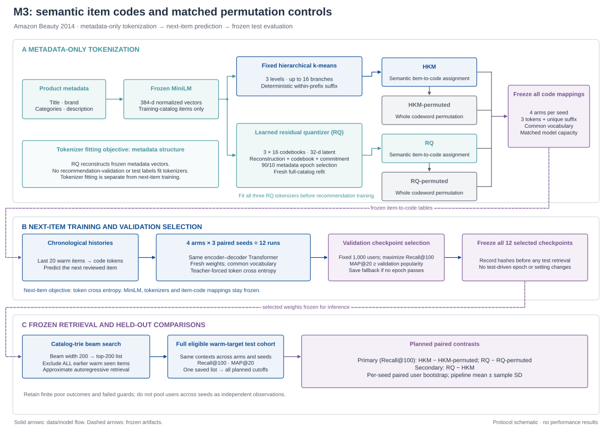
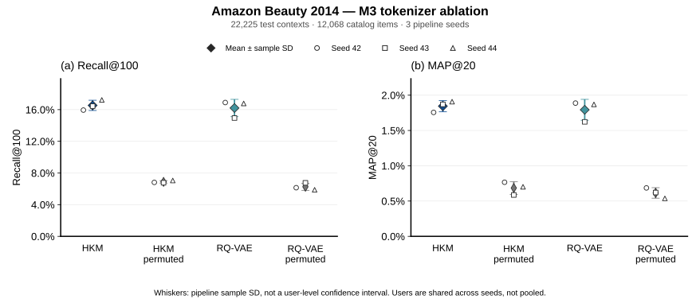
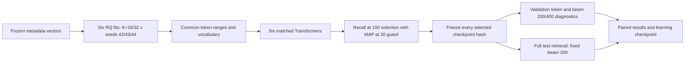
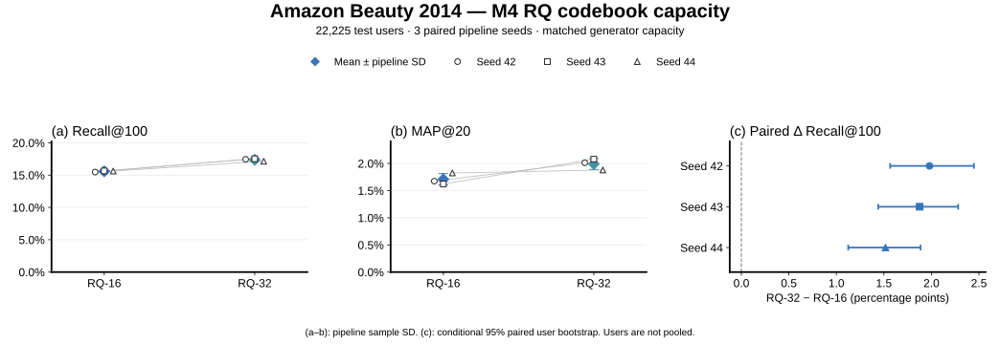

# Generative recommendation on Amazon 2014 Beauty

A readable first implementation of semantic-ID next-item retrieval.

This is a **simplified TIGER-style system** using a small PyTorch Transformer and
MiniLM metadata embeddings rather than Sentence-T5. The M2 baseline uses
hierarchical k-means; M3 adds a separately trained residual quantization
autoencoder and controlled code-permutation experiments. M4 compares 16-entry
and 32-entry residual codebooks with equal-capacity generators. It generates product
codes, not natural-language product descriptions.



**Model architecture introduced at M3.** Frozen MiniLM embeddings feed hierarchical
k-means or a separately trained residual quantization autoencoder. Each assigns
three semantic tokens plus a unique within-prefix suffix `u`.
The Transformer reads the latest 20 items as semantic codes and predicts the next
item's code. Training uses the true code prefix and token cross entropy; inference
uses generated prefixes, a catalog trie, and beam search to rank unseen products.
RQ metadata fitting and Transformer next-item training have separate objectives.
The Transformer's encoder and decoder share input embeddings;
the output projection has separate weights. Catalog constraints apply during
inference, and exclusion covers all earlier seen items.

[Paper PDF](docs/figures/m3_architecture.pdf) ·
[Editable SVG](docs/figures/m3_architecture.svg) ·
[300-dpi PNG](docs/figures/m3_architecture.png) ·
[Figure source](scripts/draw_m3_architecture.py) ·
[Detailed caption](docs/figures/m3_architecture.caption.md)

The earlier M2 architecture remains available as [PDF](docs/figures/model_architecture.pdf)
and [SVG](docs/figures/model_architecture.svg).

The project includes an **M1/M2 experiment path**: broader retrieval metrics,
a SASRec-style baseline, three-seed comparisons, and controlled AdamW/SAM
continuations. The [M2 learning checkpoint](docs/learning_checkpoint_m2.md)
explains the implemented system and its completed experiments.

**M2 completed on 2026-10-03:** three seeds, all 22,225 eligible test users, and
cutoffs 10/20/50/100/200. Generative + AdamW6 reached mean Recall@100 **0.18106**
and MAP@20 **0.02120**; SASRec reached **0.22956** and **0.03739**. SAM did not
improve Recall@100 or MAP@20 over the AdamW controls in this configuration. Read the
[complete results](docs/m2_results.md) and [M1 validation results](docs/m1_results.md).
The selected checkpoints and per-user rankings are saved locally under `results/m2/`.
**M3 completed and verified on 2026-10-03:** four arms × three seeds, all 22,225
eligible test users. Mean Recall@100 is **16.535% for HKM** and **16.205% for RQ**;
MAP@20 is **1.845%** and **1.793%**. Both aligned code mappings substantially
outperform their matched permutation controls. RQ shows no consistent advantage
over HKM in this configuration. Read the [results](docs/m3_results.md),
[frozen protocol](docs/m3_protocol.md) and [M3 learning checkpoint](docs/learning_checkpoint_m3.md).
All 12 checkpoints and every saved ranking passed the independent audit;
large artifacts are local under `results/m3/`. M3 rental cost was ¥6.19,
cumulative project cost ¥10.68; the experiment GPU is stopped and its key removed.

**M4 completed and verified on 2026-10-14:** six fresh models compare 16-entry
and 32-entry RQ codebooks across three paired pipeline seeds. With equal
generator capacity, mean full-test Recall@100 increases from **15.585% to
17.375%**, and MAP@20 from **1.708% to 1.991%**. The independent audit passed
all six checkpoints, 200,547 ranking context rows and 6,000 search-diagnostic
rows. Read the [M4 results](docs/m4_results.md) and stop at the
[M4 learning checkpoint](docs/learning_checkpoint_m4.md). Rental cost was
**¥4.13 of the ¥50 budget**, cumulative project cost **¥14.81**; the dedicated
GPU is stopped and temporary SSH access removed. Full artifacts are local in
`results/m4/`.

## Start here

The current workspace already has a local `.venv`. From PowerShell in the project
directory, run the offline functional demo:

```powershell
.\.venv\Scripts\python.exe -m beautyrec demo
```

The demo creates invented products and interactions, trains a tiny model, saves a
checkpoint, and compares recommendations with popularity. Its TF-IDF embeddings
need no model download. **These scores are synthetic diagnostics, not Amazon results.**

For a fresh checkout with Python 3.10 or later:

```powershell
python -m venv .venv
.\.venv\Scripts\python.exe -m pip install -e ".[text,dev]"
```

PyTorch installation depends on your GPU and driver. The installed environment here
uses CPU PyTorch; `--device auto` selects CUDA only when PyTorch supports it.
`configs/beauty_cpu.json` trains a smaller model on all training examples for three
epochs; `configs/beauty.json` is the larger, ten-epoch configuration.

## Run on the real Beauty dataset

Commands expose each stage, so you can inspect its output before continuing:

```powershell
.\.venv\Scripts\python.exe -m beautyrec download
.\.venv\Scripts\python.exe -m beautyrec prepare
.\.venv\Scripts\python.exe -m beautyrec embed
.\.venv\Scripts\python.exe -m beautyrec tokenize
.\.venv\Scripts\python.exe -m beautyrec train --config configs/beauty.json
.\.venv\Scripts\python.exe -m beautyrec evaluate
```

`download` retrieves the original **2014** Beauty 5-core reviews and category
metadata from Stanford, as linked by the dataset authors. If the host is
unavailable, you can provide the same files locally using `prepare --reviews ...
--metadata ...`. Do not substitute Amazon 2023 All_Beauty.

The downloader uses Stanford's HTTP file endpoint because large HTTPS transfers
timed out during local validation. It checks gzip integrity and records local
SHA-256 hashes; these are not publisher-supplied authenticity checksums.

`embed` downloads the frozen `sentence-transformers/all-MiniLM-L6-v2` encoder into
the artifact directory. All later stages reuse the saved embeddings and IDs.
Add `--device cuda` to embedding if CUDA is available. The `tfidf` backend is
available for offline debugging and is labeled diagnostic in its manifest.
The encoder uses its native text limit (256 tokens for MiniLM). An optional
`--max-text-length 128` reduces CPU work by truncating more metadata; the chosen
limit is recorded for new embedding runs and changes the experimental setting.

For a short first real-data check, use the smaller model and limited training
examples in `configs/beauty_smoke.json`:

```powershell
.\.venv\Scripts\python.exe -m beautyrec train --config configs/beauty_smoke.json --run-dir results/beauty_smoke
.\.venv\Scripts\python.exe -m beautyrec evaluate --checkpoint results/beauty_smoke/best.pt --max-examples 100 --output-dir results/beauty_smoke/evaluation
```

The smoke configuration trains on at most 2,000 randomly sampled training
examples. It checks functionality; it is not a converged benchmark.
Without `--max-examples`, final evaluation uses every eligible test example.
Decoding processes one history at a time and can be slow on a CPU.

For batched evaluation using one top-200 list per user:

```powershell
.\.venv\Scripts\python.exe -m beautyrec evaluate --cutoffs 10 20 50 100 200 --beam-size 200 --batch-size 8 --split validation --output-dir results/m1/validation
```

This saves ranked item lists and target ranks, and computes Recall, NDCG,
MAP, MRR, tail metrics, and coverage at every requested cutoff. With exactly one
next-item positive, MAP@K equals MRR@K. The legacy command without `--cutoffs`
retains its original single-history evaluation behavior.

## M1/M2 experiments

After preparing embeddings and IDs, run:

```powershell
.\.venv\Scripts\python.exe -m beautyrec benchmark --config configs/m2.json --run-dir results/m2
```

On a CUDA machine, the equivalent command is:

```bash
python -m beautyrec benchmark --config configs/m2.json --run-dir results/m2 --device cuda
```

`configs/m2.json` defines three training seeds, all training examples, and full
eligible validation/test evaluations. Each model uses the same chronological
examples and full-history exclusions. Checkpoint selection uses a fixed
1,000-user validation cohort, maximizing Recall@100 among epochs satisfying a
MAP@20 floor equal to validation popularity. A run that never satisfies the
floor saves its best fallback and explicitly reports failure.

SASRec scores every catalog item with tied embeddings and a full-softmax next-item
loss. This is a SASRec-style adaptation of the original sampled-loss model. The
generative model predicts semantic tokens, so their training losses and parameter
counts have different meanings.

For each generative seed, the runner starts AdamW and SAM continuations from the
same selected base checkpoint: three additional epochs each, plus a six-epoch
AdamW control for the extra backward passes. Both branches reset optimizer
moments, use identical minibatches, and replay dropout masks for SAM's second
pass. MiniLM stays frozen. See the [SAM protocol](docs/sam_experiment.md).

Final results include seed means/standard deviations and paired user-bootstrap
intervals, with training cost, batched throughput, warm single-request latency,
and allocated CUDA memory reported separately. The protocol and selected
checkpoint hashes are recorded before test evaluation. Completed compatible
runs can be resumed without retraining; a changed protocol requires a new folder.

`configs/m2_smoke.json` checks the runner cheaply with limited examples and one
seed. It is explicitly diagnostic and cannot establish M2 completion.

Generate recommendations from chronological **ASINs**, using products in
`data/processed/catalog.json`:

```powershell
.\.venv\Scripts\python.exe -m beautyrec recommend --history YOUR_FIRST_ASIN YOUR_SECOND_ASIN
```

Use `--checkpoint results/beauty_smoke/best.pt` if you trained the smoke config.
The displayed log probability ranks codes; it is not a calibrated purchase probability.

The existing checkpoint can be tried immediately with a real catalog history:

```powershell
.\.venv\Scripts\python.exe -m beautyrec recommend --history B007IY97U0 B00870XLDS B008MIRO88 B00BQYYMN0
```

## M3: semantic alignment and learned tokenization

```powershell
python -m beautyrec m3 --config configs/m3.json --run-dir results/m3 --device cuda
```

The four arms are HKM, whole-code-permuted HKM, learned RQ, and whole-code-permuted
RQ. First fit all three RQ tokenizers on frozen metadata, then freeze a common
vocabulary and train twelve recommenders from scratch. Each pair shares its
complete codeword set and model capacity. All selected checkpoint hashes are
recorded before test retrieval. The primary contrasts measure semantic codes
against their matched permutation controls; RQ versus HKM is secondary.



**M3 results.** Points show three pipeline seeds, and whiskers show sample SD.
Users are shared across seeds. See the [results and paired intervals](docs/m3_results.md)
and [figure caption](docs/figures/m3_tokenizer_ablation.caption.md).

[Results PDF](docs/figures/m3_tokenizer_ablation.pdf) ·
[Editable SVG](docs/figures/m3_tokenizer_ablation.svg) ·
[300-dpi PNG](docs/figures/m3_tokenizer_ablation.png) ·
[Figure source](scripts/plot_m3_results.py)

To repeat the completed artifact audit and export the results figure locally
(plotting requires the `figures` extra):

```powershell
python scripts/verify_m3_results.py --run-dir results/m3 --project-dir .
python scripts/plot_m3_results.py --run-dir results/m3 --output-dir docs/figures
```

Try a returned RQ checkpoint on the CPU, supplying warm-catalog ASINs in time order:

```powershell
.\.venv\Scripts\python.exe -m beautyrec recommend --checkpoint results/m3/seeds/seed_42/rqvae/best.pt --artifact-dir results/m3/arms/seed_42/rqvae --history B007IY97U0 B00870XLDS B008MIRO88 B00BQYYMN0 --beam-size 200 --top-k 20 --device cpu
```

The returned artifacts preserve their recorded Linux paths. The audit maps them
in memory; inference uses the explicit local checkpoint and artifact paths above.
Use a new run directory for any new training configuration.

The [M3 learning checkpoint](docs/learning_checkpoint_m3.md) includes the study
flowchart, residual-quantization math, gradient routing, and interpretation guide.

RQ epoch selection uses a metadata holdout, followed by a fresh fit on the full
warm catalog. Recommendation validation/test scores do not choose the tokenizer.
M3 retains Recall@100 selection, the popularity MAP@20 guard, full-history
exclusion, three seeds, and full final evaluation at 10/20/50/100/200. Optimizer
continuations and a new dataset belong to separate experiments.

See the [protocol](docs/m3_protocol.md) and
[M3 learning checkpoint](docs/learning_checkpoint_m3.md). `configs/m3_smoke.json`
is a limited synthetic diagnostic configuration and cannot complete M3.

## M4: codebook capacity and search diagnosis

M4 compares three 16-entry residual codebooks with three 32-entry codebooks,
using three paired pipeline seeds. All six tokenizers are fitted before
recommendation training. Common semantic ranges start at 3/35/67; suffixes start
at 99. The largest collision group has 64 products, so all six generators use
vocabulary 163 and exactly **704,931 parameters**. The larger tokenizer adds
1,536 offline codebook parameters. Training starts from fresh generator weights.



The [frozen protocol](docs/m4_protocol.md) specifies the comparison before results.
The [M4 learning checkpoint](docs/learning_checkpoint_m4.md) explains capacity
matching, token likelihoods, search certificates and uncertainty.



Read the [results and limitations](docs/m4_results.md),
[complete numeric tables](docs/m4_numeric_tables.md),
[verification record](docs/m4_verification.json), and
[figure caption](docs/figures/m4_capacity_comparison.caption.md).
The three-seed Recall@100 difference is **+1.791 ± 0.243 percentage points**
(mean ± sample SD). Conditional user intervals and pipeline variation measure
different uncertainty; these test users were previously evaluated in M2/M3.

[Results PDF](docs/figures/m4_capacity_comparison.pdf) ·
[Editable SVG](docs/figures/m4_capacity_comparison.svg) ·
[300-dpi PNG](docs/figures/m4_capacity_comparison.png) ·
[Figure source](scripts/plot_m4_results.py)

```powershell
python scripts/run_m4.py --config configs/m4.json --run-dir results/m4 --device cuda
python scripts/verify_m4_results.py --run-dir results/m4 --project-dir .
python scripts/summarize_m4_results.py --run-dir results/m4 --output-dir docs
python scripts/plot_m4_results.py --run-dir results/m4 --output-dir docs/figures
```

Training needs the prepared Beauty inputs and a compatible CUDA environment.
The AutoDL launcher is `scripts/run_m4_gpu.sh`; its shell must have the intended
Python runtime on `PATH`. A process timeout does not stop paid GPU billing:
configure the provider shutdown timer before launching. Audit, summary export
and plotting run locally on CPU after artifact return.

Try the returned seed-42 RQ-32 checkpoint on CPU:

```powershell
python -m beautyrec recommend --checkpoint results/m4/seeds/seed_42/rq32/best.pt --artifact-dir results/m4/arms/seed_42/rq32 --history B007IY97U0 B00870XLDS B008MIRO88 B00BQYYMN0 --beam-size 200 --top-k 20 --device cpu
```

## Understand the code

| Module | Responsibility |
|---|---|
| `src/beautyrec/data.py` | Downloads, safe parsing, deduplication, chronological examples and catalog |
| `src/beautyrec/embeddings.py` | Frozen metadata embeddings and offline debugging features |
| `src/beautyrec/semantic_ids.py` | Hierarchical k-means, deterministic unique codes and diagnostics |
| `src/beautyrec/rqvae.py` | Residual quantization, gradient routing, metadata selection and full-catalog refit |
| `src/beautyrec/tokenizer_diagnostics.py` | Matched code permutations, usage/collisions, semantic locality and interaction exposure |
| `src/beautyrec/model.py` | Position encodings, history encoder and causal target decoder |
| `src/beautyrec/decoding.py` | Valid-code trie and catalog-constrained beam search |
| `src/beautyrec/training.py` | Teacher forcing, checkpoint selection, evaluation and experiment records |
| `src/beautyrec/metrics.py` | Recall, NDCG, MAP/MRR, and explicit AP conventions |
| `src/beautyrec/evaluation.py` | Saved rankings, paired bootstrap intervals and seed aggregation |
| `src/beautyrec/sasrec.py` | Causal item-history baseline with full-catalog scoring |
| `src/beautyrec/batched_decoding.py` | Cached trie and batched constrained beam search |
| `src/beautyrec/retrieval.py` | Shared retrieval, exclusions, throughput and request timings |
| `src/beautyrec/optimizers.py` | Two-pass SAM with exact parameter restoration |
| `src/beautyrec/experiment_training.py` | Shared M2 training, validation guards and continuations |
| `src/beautyrec/benchmark.py` | Reproducible multi-seed experiment orchestration and reports |
| `src/beautyrec/m4_benchmark.py` | Common token ranges, six fresh fits, frozen selection and capacity comparison |
| `src/beautyrec/m4_diagnostics.py` | Validation token likelihoods, prefix coverage and search-ranking certificates |
| `src/beautyrec/m3_benchmark.py` | Frozen tokenizer controls, common capacity and M3 orchestration |
| `src/beautyrec/cli.py` | Thin command-line orchestration |

Start reading `model.py`, then `decoding.py`, then `training.py`. Configuration
uses ordinary JSON files and dataclasses. Core algorithms live in the package,
with short docstrings and comments explaining decisions rather than every line.
Training groups similar history lengths into batches and shuffles those batches
each epoch. This reduces padding on a CPU while retaining every training example.
Set `bucket_by_history_length` to `false` for ordinary randomly mixed batches.

The architecture figure is generated by `scripts/draw_architecture.py`. It reads
the M2 model dimensions from `configs/m2.json` and needs no data, checkpoint, or
GPU. To regenerate its SVG, PDF, and PNG exports:

```powershell
python -m pip install -e ".[figures]"
python scripts/draw_architecture.py
```

The figure describes the generative model. Popularity and SASRec are separate
evaluation baselines; AdamW/SAM continuations compare optimizers on this same
architecture.

## Semantic IDs and the learning objective

At each level, k-means groups products inside the current parent cluster.
Products in similar groups share code prefixes. Three semantic levels are used
by default; each level has its own token range. A fourth, leaf-local token
distinguishes products that land in the same leaf, including identical metadata.
PAD, BOS and EOS are reserved as tokens 0, 1 and 2.

An item might therefore have a code such as `[7, 22, 40, 54]`. Its exact values
are arbitrary; shared prefixes carry the useful structure. Codes are always
unique and fixed-length. Tiny or identical clusters use a zero cluster index at
remaining levels, not the PAD token.

Let $c(i)=(c_1,\ldots,c_L)$ be item $i$'s code and $h$ the user's past history.
The Transformer minimizes teacher-forced token cross entropy:

$$
\mathcal L = -\sum_{t=1}^{L+1}\log p_\theta(c_t\mid c_{<t},h),
\qquad c_{L+1}=\mathrm{EOS}.
$$

The decoder input is `BOS + item code`; the labels are `item code + EOS`.
Causal masking prevents future target tokens from reaching earlier predictions.
During inference, a trie permits only catalog-code continuations. Previously
seen items are removed before beam pruning. Beam scores sum full-vocabulary log
probabilities; constraints do not renormalize them. Beam search approximates
retrieval over the full eligible catalog without sampled negative candidates.

## Data and evaluation protocol

- Reviews are an implicit-interaction proxy. Their timestamps are review times,
  not purchase times. Ratings are not used to decide relevance in this version.
- Duplicate `(user, ASIN)` pairs retain their earliest review. Users need at
  least five distinct reviewed items by default. Tied timestamps use ASIN order,
  which is deterministic but cannot recover the true order of same-day events.
- Each user's final two items become validation and test targets. Every earlier
  prefix with at least one history item becomes a training example. This is a
  **per-user chronological split**, not a global time cutoff: another user's
  training event may occur after an evaluated prediction.
- The catalog includes only items occurring in training interactions. Unknown
  validation/test targets are dropped and counted; unknown history items are
  filtered. This version evaluates **warm-item retrieval**, not cold-start.
- The encoder reads at most 20 recent items. A separate `seen_items` field keeps
  all prior warm items for exclusion by both the model and popularity baseline.
- Popularity counts original training interactions once, not repeated prefix
  examples. Product embeddings use title, brand, categories and description;
  review text, sales rank, co-purchase links and aggregate ratings are excluded.
- MiniLM and clustering see only the training catalog's metadata. Metadata are
  historical dataset snapshots, not a verified point-in-time feature store.
  The supplied 5-core subset was itself filtered using the full review period.
- Validation NDCG@10 selects the checkpoint. By default, a fixed random subset
  of 256 validation users reduces early-stopping cost. Test data are not used to
  select a checkpoint. Report the final evaluation's sample size explicitly.
- Recall@K is a hit indicator for the one held-out next item; NDCG@K discounts its
  rank. Tail items have training frequency at or below the catalog median,
  including ties. Coverage is distinct recommended items divided by catalog size.
- Latency measures single-history decoding on the current device, including
  initial calls, and excludes metadata encoding. It is a diagnostic timing,
  not a production throughput benchmark.

The M2 path adds SASRec as a stronger comparison; M3 adds matched shuffled-code
controls and learned residual quantization. Popularity is a sanity check. Single-seed smoke results do not
establish superiority, and paper scores require matching preprocessing protocols.

## Saved outputs

```text
data/raw/                 Original compressed files and download checksums
data/processed/           Catalog, mappings, split examples, counts and statistics
artifacts/beauty/          Embeddings, encoder manifest, semantic IDs and diagnostics
results/beauty/           Config, best.pt, epoch metrics and validation summary
results/beauty/evaluation/ Per-user metrics and aggregate test summary
results/demo/             Synthetic diagnostic artifacts
results/m1/               Broader evaluation of the initial checkpoint
results/m2/               Frozen protocol, seed runs, rankings and comparison report
results/m3/               RQ fits, tokenizer manifests, four-arm seed runs and planned contrasts
results/m4/               Six RQ fits, matched generators, search diagnostics and paired contrasts
```

Catalog, tokenizer and interaction-file checksums prevent silently mixing a
checkpoint with reordered items or changed data splits. Seeds and resolved
configuration are saved. Hardware and library changes can still affect numerical
reproducibility. `requirements-lock.txt` records the tested environment.

Dataset and model files are excluded from Git. Share code and download instructions,
and follow the dataset authors' terms when using the data.

## Checks

```powershell
.\.venv\Scripts\python.exe -m pytest -q
.\.venv\Scripts\python.exe -m ruff check src tests
```

Tests cover temporal splits, unsafe input rejection, full-history exclusion,
tokenizer collisions, causal attention, valid catalog decoding and a complete
training/evaluation/checkpoint round trip.

## Current local validation

The initial M0 pipeline was validated on 2026-10-02 with Python 3.12.14 and CPU
PyTorch: 42 tests passed. M1/M2 extend the tests with hand-worked metrics, paired
evaluation, causal SASRec, batched decoding, SAM, and experiment orchestration.
Both local and RTX 5090 environments passed 159 tests and Ruff for the completed
M2 run. GPU PyTorch was 2.12.1+cu130; its observed package list is saved in
`results/runtime-requirements.txt`.

The M3 implementation passed **222 local CPU and GPU tests** and Ruff on
2026-10-03, a real four-arm synthetic smoke run, and the full Amazon study.
M4 passed **225 local CPU and GPU tests** and Ruff on 2026-10-14, plus a real
two-arm synthetic run and an independent audit of its returned artifacts.
Synthetic smoke scores do not establish Amazon performance.

The original dataset contains 198,502 reviews from 22,363 users. Preparation
produced 131,413 training examples and 12,068 warm catalog items. All items have
unique four-token codes using a vocabulary of 94 tokens. Frozen MiniLM embeddings
were cached for the entire warm catalog.

`results/beauty/best.pt` is a 96,094-parameter Transformer trained for three epochs
on all training examples using `configs/beauty_cpu.json`. Checkpoint selection
used 256 validation examples. Training loss fell from 2.0684 to 1.8529.

The saved pilot evaluation uses 1,000 randomly selected eligible test users,
seed 42, K=10 and beam size 20:

| Method | Recall@10 | NDCG@10 | Catalog coverage |
|---|---:|---:|---:|
| Generative semantic-ID model | 0.0140 | 0.00691 | 4.35% |
| Training popularity | 0.0140 | 0.00652 | 0.12% |

These results verify that the real-data pipeline trains and retrieves valid
products. Both methods found 14 held-out targets; the small NDCG difference is
insufficient evidence of better recommendation quality. The model's broader
coverage is observed in this pilot. Longer training, stronger baselines and
multiple seeds are needed before making a performance claim.

Detailed outputs are in `results/beauty/evaluation/summary.json`,
`results/beauty/evaluation/per_user_metrics.csv`, and
`results/beauty/example_recommendations.json`. Windows CLI output uses UTF-8 to
preserve product names containing symbols and accented characters.

## References

- [Amazon Reviews 2014 dataset](https://cseweb.ucsd.edu/~jmcauley/datasets/amazon/links.html)
- [TIGER: Recommender Systems with Generative Retrieval](https://arxiv.org/abs/2305.05065)
- [DSI: Transformer Memory as a Differentiable Search Index](https://arxiv.org/abs/2202.06991)
- [MiniLM sentence encoder](https://huggingface.co/sentence-transformers/all-MiniLM-L6-v2)
- [SASRec paper](https://arxiv.org/abs/1808.09781)
- [Sharpness-Aware Minimization](https://arxiv.org/abs/2010.01412)
- [Average precision definition](https://nlp.stanford.edu/IR-book/html/htmledition/evaluation-of-ranked-retrieval-results-1.html)
