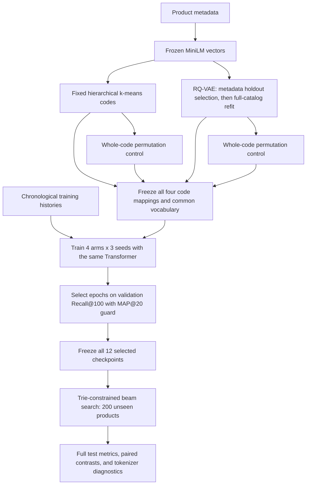

# M3 learning checkpoint

M3 asks whether semantic item codes help the generative recommender, and whether
a learned residual quantizer is a useful replacement for hierarchical k-means.
Completed and independently verified on 2026-10-03. Start with the
[frozen experiment protocol](m3_protocol.md), then read the [actual results](m3_results.md).
Implementation pauses at this learning checkpoint before another milestone.

## What changes from M2

The Beauty data, frozen MiniLM vectors, chronological splits, encoder–decoder
architecture, training objective, and retrieval protocol stay fixed. M3 changes
the mapping between products and codes. Four arms compare HKM and RQ codes with
their respective whole-code permutations. Each arm uses a common vocabulary and
the same three recommender initialization seeds.

The tokenizer is trained separately from the recommender. RQ training reconstructs
metadata vectors; recommender training predicts the next reviewed item. Strong
metadata reconstruction alone does not establish strong recommendations.

## Walkthrough

1. **Code permutation.** Inspect one saved `item_to_source_item` mapping. Show
   that the product identities change but the complete set of codes stays equal.
   Explain why shuffling each code position independently would lose this control.
2. **Residual quantization.** Encode one product vector into $z$. At each level,
   choose the closest centroid, subtract it, and pass the residual to the next
   level. Sum the selected centroids to recover the quantized latent vector.
3. **Gradient routing.** Explain the stop-gradient operator and the straight-through
   expression $q_{\mathrm{ST}}=z+\operatorname{sg}(q-z)$. Its forward value is $q$,
   while its reconstruction derivative with respect to $z$ is the identity.
   Check that the codebook loss updates centroids, commitment loss updates the
   encoder, and reconstruction updates the encoder and decoder.
4. **Three different spaces.** Distinguish MiniLM's 384-dimensional metadata
   vectors, the tokenizer's 32-dimensional latent vectors, and the recommender's
   128-dimensional token embeddings. They are learned or frozen at different times.
5. **Collisions and capacity.** Three 16-way levels provide at most $16^3=4096$
   prefixes for 12,068 products. Explain why a suffix is necessary and why its
   maximum value changes vocabulary size. Verify equal recommender parameter
   counts after padding every arm to the common vocabulary.
6. **Two-stage metadata fitting.** Identify the metadata fit/validation split used
   to select an epoch count. Follow the fresh full-catalog refit and explain why
   recommendation validation and test labels never select the tokenizer.
7. **Diagnostics.** Interpret active codes, entropy/perplexity, largest code share,
   collision sizes, cosine-neighbor prefix agreement, and reconstruction error.
   Compare catalog occupancy with interaction-weighted code exposure.
8. **Recommendation evidence.** Read the two planned semantic-minus-permuted
   contrasts. Compare their three seed differences and paired user-bootstrap
   intervals. A difference between RQ and HKM also includes differences in code
   geometry, suffix burden, search difficulty, and tokenizer capacity.

## Read the diagnostic numbers

The [actual tokenizer diagnostics](m3_tokenizer_diagnostics.md) are ready. Convert
a reconstruction squared-L2 sum of about 0.468 into coordinate MSE by dividing
by 384: about 0.001219. For a unit-normalized vector, an all-zero reconstruction
has coordinate MSE 1/384. These numbers describe metadata reconstruction;
recommendation quality requires the separate retrieval experiment.

The common vocabulary has 133 tokens, compared with M2's 94. Each additional
token adds 128 input-embedding weights, 128 output-projection weights and one
output bias. Check `(133 - 94) * (128 + 128 + 1) = 10,023`: M3's generator has
697,221 parameters instead of 687,198. The capacity match applies within M3;
the earlier M2 run is contextual evidence rather than its matched control.

Open the [paper-style M3 schematic](figures/m3_architecture.pdf) beside the
code. Follow the solid data arrows and the dashed frozen-artifact arrows before
reading the two objectives or the final contrasts.

## Questions to answer from the saved results

- Does each semantic tokenizer beat its matched shuffled-code control on
  Recall@100, and what happens to MAP@20?
- Is the direction consistent across all three seeds? What uncertainty remains?
- Do the metadata-neighbor diagnostics establish locality, even if retrieval
  does not improve?
- Can lower reconstruction error coexist with worse next-item retrieval? Why?
- Does a larger suffix burden force more predictions to behave like arbitrary
  item identification rather than semantic sharing?
- How much offline fitting and online retrieval cost does each tokenizer add?
- What evidence would justify a larger codebook, a new dataset, or a reranker?

## Work through the actual experiment

Read [the M3 results](m3_results.md) beside the frozen protocol. Start with the
two primary comparisons: HKM minus HKM-permuted gains 9.659 Recall@100 percentage
points on average; RQ minus RQ-permuted gains 9.948. Identify the exact matched
properties in the saved artifacts, then explain why changed interaction-weighted
code frequencies prevent a pure semantic causal interpretation.

Next inspect RQ minus HKM by seed: +0.954, −1.498 and −0.445 Recall@100 points.
Its average is −0.330, with sample SD 1.230. Explain why a positive result for
seed 42 is insufficient to choose RQ as the better tokenizer. The within-seed
bootstrap interval addresses a different uncertainty from the three-seed SD.
Neither the mixed result nor overlapping seed distributions establish equivalence.

Verify the MAP guard in one `best_validation.json` and `training_summary.json`.
The chosen epoch must maximize Recall@100 among qualifying epochs on the fixed
1,000-user validation cohort. The 0.543975% floor is validation popularity;
the 0.416% test-popularity MAP@20 belongs to a different cohort. Explain why
the guard is a selection constraint rather than a guarantee for future users.

Finally, open one saved test ranking. Locate its target among the 200 unseen
products and reconstruct Recall@10/100/200 and MAP@20 from that one list. A
target at rank 37 contributes 0/1/1 to those recall cutoffs and zero to MAP@20;
at rank 7 it contributes 1/1/1 and 1/7. Connect this calculation to teacher
forcing, full-vocabulary token probabilities and trie-constrained beam search.

M3 completion means the controlled study is implemented, verified, and reported.
Improvement over HKM or SASRec is an experimental outcome, not a completion rule.
