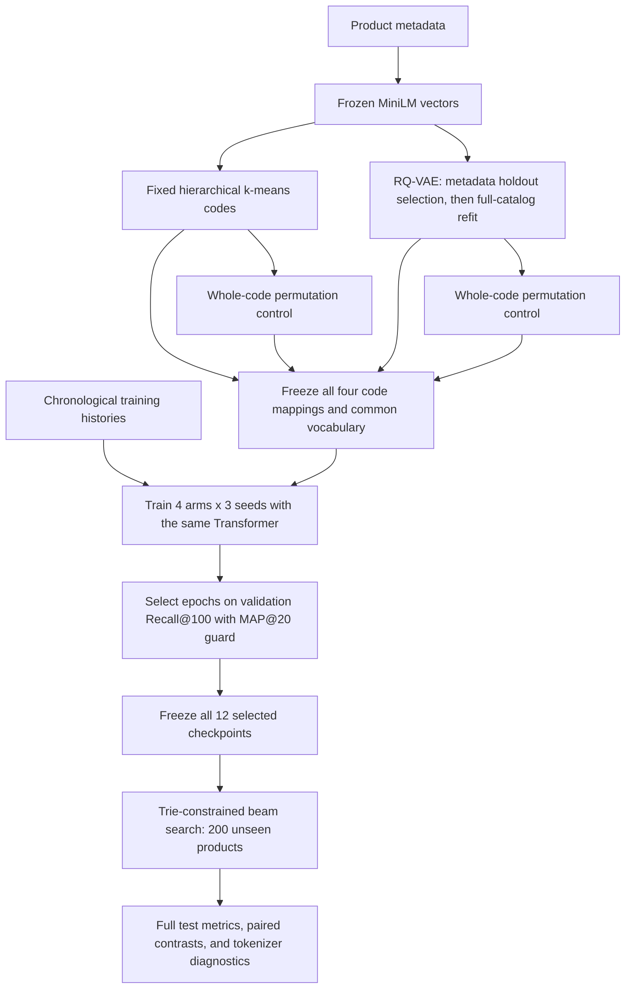

# M3 learning checkpoint

M3 asks whether semantic item codes help the generative recommender, and whether
a learned residual quantizer is a useful replacement for hierarchical k-means.
Start with the [frozen experiment protocol](m3_protocol.md). Results and a final
interpretation will be added after all planned runs and evaluations finish.

## What changes from M2

The Beauty data, frozen MiniLM vectors, chronological splits, encoder–decoder
architecture, training objective, and retrieval protocol stay fixed. M3 changes
the mapping between products and codes. Four arms compare HKM and RQ codes with
their respective whole-code permutations. Each arm uses a common vocabulary and
the same three recommender initialization seeds.

The tokenizer is trained separately from the recommender. RQ training reconstructs
metadata vectors; recommender training predicts the next reviewed item. Strong
metadata reconstruction alone does not establish strong recommendations.

## Walkthrough

1. **Code permutation.** Inspect one saved `item_to_source_item` mapping. Show
   that the product identities change but the complete set of codes stays equal.
   Explain why shuffling each code position independently would lose this control.
2. **Residual quantization.** Encode one product vector into $z$. At each level,
   choose the closest centroid, subtract it, and pass the residual to the next
   level. Sum the selected centroids to recover the quantized latent vector.
3. **Gradient routing.** Explain the stop-gradient operator and the straight-through
   expression $q_{\mathrm{ST}}=z+\operatorname{sg}(q-z)$. Its forward value is $q$,
   while its reconstruction derivative with respect to $z$ is the identity.
   Check that the codebook loss updates centroids, commitment loss updates the
   encoder, and reconstruction updates the encoder and decoder.
4. **Three different spaces.** Distinguish MiniLM's 384-dimensional metadata
   vectors, the tokenizer's 32-dimensional latent vectors, and the recommender's
   128-dimensional token embeddings. They are learned or frozen at different times.
5. **Collisions and capacity.** Three 16-way levels provide at most $16^3=4096$
   prefixes for 12,068 products. Explain why a suffix is necessary and why its
   maximum value changes vocabulary size. Verify equal recommender parameter
   counts after padding every arm to the common vocabulary.
6. **Two-stage metadata fitting.** Identify the metadata fit/validation split used
   to select an epoch count. Follow the fresh full-catalog refit and explain why
   recommendation validation and test labels never select the tokenizer.
7. **Diagnostics.** Interpret active codes, entropy/perplexity, largest code share,
   collision sizes, cosine-neighbor prefix agreement, and reconstruction error.
   Compare catalog occupancy with interaction-weighted code exposure.
8. **Recommendation evidence.** Read the two planned semantic-minus-permuted
   contrasts. Compare their three seed differences and paired user-bootstrap
   intervals. A difference between RQ and HKM also includes differences in code
   geometry, suffix burden, search difficulty, and tokenizer capacity.

## Questions to answer from the saved results

- Does each semantic tokenizer beat its matched shuffled-code control on
  Recall@100, and what happens to MAP@20?
- Is the direction consistent across all three seeds? What uncertainty remains?
- Do the metadata-neighbor diagnostics establish locality, even if retrieval
  does not improve?
- Can lower reconstruction error coexist with worse next-item retrieval? Why?
- Does a larger suffix burden force more predictions to behave like arbitrary
  item identification rather than semantic sharing?
- How much offline fitting and online retrieval cost does each tokenizer add?
- What evidence would justify a larger codebook, a new dataset, or a reranker?

M3 completion means the controlled study is implemented, verified, and reported.
Improvement over HKM or SASRec is an experimental outcome, not a completion rule.
