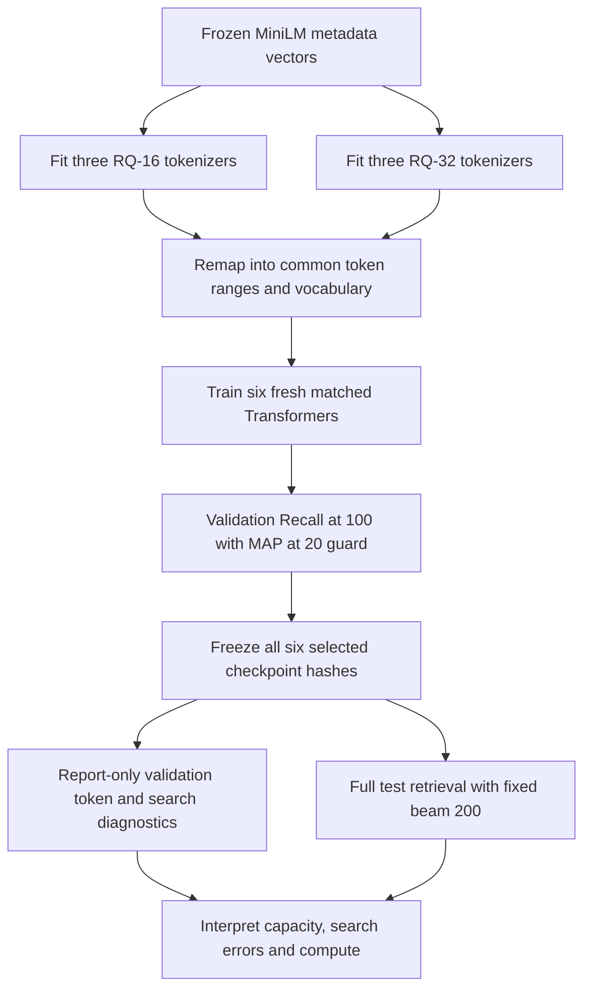

# M4 learning checkpoint: capacity, token errors and beam search

The study compares two learned RQ tokenizers, with 16 or 32 entries at each of
three residual levels. The generator architecture remains the same. Read the
[frozen protocol](m4_protocol.md) before interpreting the final results.

## Follow one product through the common vocabulary

RQ-16 naturally uses semantic ranges starting at 3/19/35 and suffixes at 51.
M4 reserves 32 slots at every level for both arms, starting at 3/35/67, with
suffixes starting at 99. An RQ-16 code `[3,19,35,52]` becomes `[3,35,67,100]`.
The semantic indices and the within-prefix suffix index do not change.

Explain why all six tokenizers must be fitted before choosing a common suffix
capacity. If their largest collision group contains $M$ products, every
generator uses vocabulary $V=99+M$. Check the saved checkpoint tensor shapes
and parameter counts: equal Transformer dimensions alone would not match
capacity if embedding/output vocabulary sizes differed.

The observed largest group is 64, giving $V=163$ and 704,931 generator
parameters. M3 used $V=133$ and 697,221 parameters. With embedding width 128,
the extra 30 vocabulary entries add $30(128+128+1)=7710$ parameters: one input
embedding, one untied output row and one output bias per entry. This is why
M3's RQ score is context rather than the matched RQ-16 control for M4.

The tokenizer's parameter count intentionally changes. Each of three codebooks
adds $16\times32$ embedding parameters when moving from 16 to 32 entries. The
extra tokenizer parameters are $3\times16\times32=1536$. These are offline
tokenizer parameters, distinct from the recommender's token embeddings.

Equal generator capacity does not mean equal difficulty. Larger codebooks change
the product partitions, target-token frequencies and branching of the catalog
trie. This study measures their combined effect under a fixed training recipe;
it does not isolate collision reduction from every other representation change.

## Separate three questions

1. **Representation:** do larger codebooks reduce collisions while preserving
   useful metadata neighborhoods? Read the original tokenizer summaries and the
   canonical arm diagnostics. Occupancy, entropy and reconstruction are
   diagnostics, not next-item accuracy.
2. **Prediction:** what is each target token's negative log probability under
   teacher forcing? Earlier target tokens are supplied correctly. These losses
   do not measure the chance of surviving free-running beam search. The suffix
   and semantic tokens also have different label distributions.
3. **Search:** does beam pruning lose a target the model scores highly? If an
   absent eligible target has higher full-sequence likelihood than the retained
   200th candidate, the returned list is not the exact highest-scoring top 200,
   within numerical tolerance. This does not prove that the target itself is in
   the exact top 200: other unreturned items could score even higher. The saved
   `certified_search_miss` counts such ranking violations, not guaranteed lost
   oracle hits. Uncertified search errors can also exist.

Increasing codebook size trades off finer product partitions and less suffix
competition against more semantic labels, sparser label counts and different
beam pruning. Use the measured token losses and validation search changes to
form hypotheses. They do not isolate the causal contribution of each mechanism.

Inspect one `search_diagnostics/per_user.jsonl` record. Sum its five target
token log probabilities, including EOS. Compare this score with the retained
candidate scores and trace the boolean `certified_search_miss`. Full earlier
seen-item exclusions must be identical for both diagnostic beam widths.

For example, an omitted target with score −9.9 outranks a retained candidate
scoring −10.0, so the returned list cannot be exact. If 250 other omitted
products score −9.0, that target still falls outside the exact top 200. This is
why a certificate alone cannot quantify lost oracle recall.

Token argmax accuracy uses the full vocabulary, before catalog constraints.
At retrieval time the trie permits only valid continuations. Teacher forcing
also supplies the correct earlier target tokens, unlike free-running decoding.
Neither operation makes token accuracy interchangeable with item Recall@K.

## Interpret the experiment honestly

The 200/400 beam comparison uses validation users only. The full test beam stays
at 200 even if the wider validation beam looks better. Prefix coverage means a
retrieved item shares a prefix with the target; it does not prove a suffix error
or quantify the exact target's probability.

Read RQ-32 minus RQ-16 for each seed before the overall mean. Explain the
difference between sample SD across three pipeline fits and a paired
user-bootstrap interval conditional on one fitted pair. RQ and Transformer
initializations both vary across pipeline seeds; repeated users are not pooled.

Compare Recall@100, MAP@20, coverage, training cost and latency together. A
larger codebook can reduce collisions yet worsen next-item prediction. Equal
maximum epoch budgets can lead to different early-stopping epochs. M3's old
scores are context because its vocabulary and generator capacity differed.

For this one-positive next-item task, MAP@20 equals MRR@20: contribute $1/r$ if
the held-out target has rank $r\leq20$, otherwise zero, then average over users.
The popularity-based validation guard checks a modest minimum; passing it does
not establish superiority over SASRec or guarantee better full-test MAP.

The M2/M3 test cohort has already been examined. This is a frozen prospective
follow-up on the same benchmark, not a fresh blind test. A later data stage
should provide external confirmation of whichever conclusions survive M4.

## Read the measured result

M4 is complete: RQ-32 raises mean full-test Recall@100 from **15.585% to
17.375%**, and MAP@20 from **1.708% to 1.991%**. Recall improves in all three
pipeline seeds. The seed-44 conditional MAP interval includes zero.
Read the [results report](m4_results.md), [numeric tables](m4_numeric_tables.md)
and [verification record](m4_verification.json).

1. Explain why all generators have 704,931 parameters although tokenizer
   parameters differ, and why historical M3 scores are contextual.
2. Trace how collision-group membership falls from 93.863% to 62.523%, while
   suffix NLL falls and first/second semantic-token NLL rises.
3. Compare seed 42's RQ-32 validation beam 200 and 400: ranking certificates
   fall from 22 to zero, Recall@200 rises from 30.2% to 31.0%, but Recall@100
   rises only from 23.2% to 23.3%. Explain why zero certificates do not prove
   exact search and why recall need not be monotone in beam width.
4. Inspect RQ-32's lower three-token prefix coverage despite higher exact-item
   recall. Explain how collision-group size affects this diagnostic.
5. Distinguish the **+1.791 ± 0.243 point** pipeline Recall@100 difference from
   each fitted pair's conditional bootstrap interval. RQ-16 uses 48 total
   training epochs and RQ-32 uses 60; this is not an equal-update comparison.

Use [m4_benchmark.py](../src/beautyrec/m4_benchmark.py) for orchestration,
[m4_diagnostics.py](../src/beautyrec/m4_diagnostics.py) for score calculations,
and [verify_m4_results.py](../scripts/verify_m4_results.py) for the independent
audit. Revisit [the M3 checkpoint](learning_checkpoint_m3.md) for the RQ
objective and gradient routing.

All planned artifacts passed the audit and are saved locally. The dedicated
GPU is stopped, temporary SSH access is removed, and the settled rental is
**¥4.13** of the **¥50** budget. Cumulative project spending is **¥14.81**.
Stop here and work through this checkpoint before another experiment.
