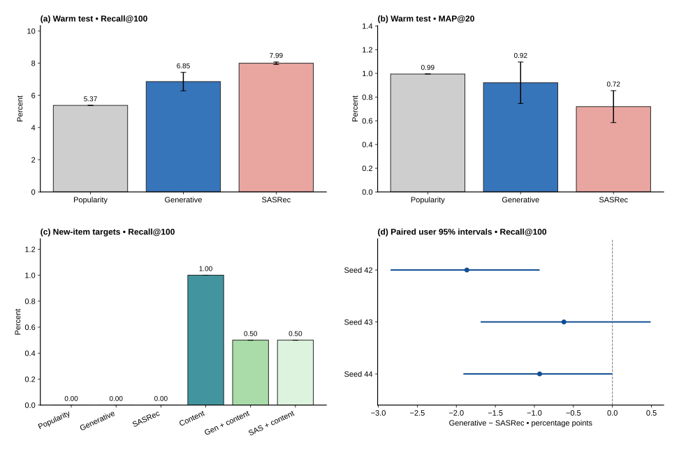

# M5 results: temporal Amazon 2023 recommendation

Six fresh recommendation models compare the frozen RQ-32 generative recipe with SASRec across three pipeline seeds. A separate mixed-catalog test evaluates fixed content retrieval and rank fusion. All selected checkpoint hashes were frozen before final evaluation.

## Warm eligible test

Values are mean ± sample SD across three seeds. SD describes pipeline variation, not a confidence interval. Popularity and pure content are deterministic controls.

| Method | Recall@20 | Recall@100 | Recall@200 | MAP@20 |
|---|---:|---:|---:|---:|
| Popularity | 1.998 ± 0.000% | 5.373 ± 0.000% | 8.215 ± 0.000% | 0.994 ± 0.000% |
| Generative | 2.916 ± 0.136% | 6.853 ± 0.573% | 9.962 ± 0.356% | 0.921 ± 0.175% |
| SASRec | 2.872 ± 0.296% | 7.993 ± 0.077% | 11.412 ± 0.203% | 0.719 ± 0.135% |

The primary mean Recall@100 difference (generative minus SASRec) is **-1.140 percentage points**. The paired seed-difference sample SD is 0.647 points.

| Pipeline seed | Recall@100 difference (points) | Conditional user 95% interval |
|---|---:|---:|
| 42 | -1.865 | [-2.842, -0.933] |
| 43 | -0.622 | [-1.688, +0.490] |
| 44 | -0.933 | [-1.909, +0.000] |

Intervals use 1,000 paired user-bootstrap resamples separately within each seed. They condition on trained weights, selected catalog and eligible contexts. Repeated seeds are not pooled as additional users; intervals are not simultaneous across metrics.

## Warm/new available catalog

The closed models emit only warm items. Their new-target recall is structurally zero. New-item reach belongs to the frozen content route. Equal-weight reciprocal-rank fusion uses constant 60 and 200 candidates per branch, without test tuning.

| Method | Mixed Recall@100 | Mixed MAP@20 | Warm Recall@100 | New Recall@100 |
|---|---:|---:|---:|---:|
| Popularity | 4.935 ± 0.000% | 0.913 ± 0.000% | 5.373 ± 0.000% | 0.000 ± 0.000% |
| Generative | 6.294 ± 0.526% | 0.846 ± 0.161% | 6.853 ± 0.573% | 0.000 ± 0.000% |
| SASRec | 7.341 ± 0.071% | 0.661 ± 0.124% | 7.993 ± 0.077% | 0.000 ± 0.000% |
| Content | 2.162 ± 0.000% | 0.067 ± 0.000% | 2.265 ± 0.000% | 1.000 ± 0.000% |
| Gen + content | 5.519 ± 0.366% | 0.457 ± 0.021% | 5.965 ± 0.398% | 0.500 ± 0.000% |
| SAS + content | 5.696 ± 0.239% | 0.472 ± 0.021% | 6.157 ± 0.260% | 0.500 ± 0.000% |

There are 2,252 warm eligible test users and 2,452 mixed eligible users, including 200 new-item targets. The expanded catalog covers 45.65% of active cohort users' first test targets. Quality is conditional on eligibility. See the [dataset card](m5_data_card.md) for unavailable targets, frozen histories, and the historical metadata limitation.

## Interpretation and next work

Among learned branches, generative minus SASRec changes mean warm Recall@100 by -1.140 points and MAP@20 by +0.201 points. 6 of 6 selected checkpoints pass the validation guard. Models with mean test MAP@20 below popularity: Generative, SASRec. A validation constraint does not guarantee quality under a later temporal distribution.

Generative + content changes mixed Recall@100 by -0.775 points and MAP@20 by -0.389 points. SASRec + content changes mixed Recall@100 by -1.645 points and MAP@20 by -0.188 points. At Recall@100, new-item hit counts are 2 for pure content, 1 for generative + content, and 1 for SASRec + content out of 200 targets per seed. Repeated identical cold hit counts do not create more independent evidence. New-item reach is implemented; these small observed hit counts limit claims about its quality.

This is a complete research and inference prototype with measured limitations. The preselected hybrid API default demonstrates a capability; the results do not validate it as a production policy. Keep the dataset and diagnose ranking and new-item retrieval before changing many components. See the [next-study options](after_m5.md) after the code-review checkpoint.

## Training and inference resources

Hardware: NVIDIA RTX PRO 6000 Blackwell Server Edition, 97887 MiB, 595.58.03. PyTorch 2.12.1+cu130; CUDA 13.0. Learned recommendation parameter counts are not matched between architectures.

| Seed | Model | Parameters | Selected epoch / completed | Train minutes | MAP guard |
|---|---|---:|---:|---:|---|
| 42 | Generative | 711,613 | 4 / 9 | 5.36 | pass |
| 42 | SASRec | 5,174,912 | 2 / 7 | 2.75 | pass |
| 43 | Generative | 711,613 | 12 / 17 | 12.61 | pass |
| 43 | SASRec | 5,174,912 | 2 / 7 | 2.67 | pass |
| 44 | Generative | 711,613 | 19 / 20 | 14.82 | pass |
| 44 | SASRec | 5,174,912 | 2 / 7 | 2.81 | pass |

Checkpoint selection maximizes validation Recall@100 subject to MAP@20 at least popularity, on the same fixed 1,000 users. Single-positive MAP equals MRR. The serving seed is prespecified as 42, independently of test performance.

| Model | Warm mean ms | Mean of seed p95 ms | Test batch histories/s |
|---|---:|---:|---:|
| Generative | 11.11 | 12.06 | 780.9 |
| SASRec | 1.33 | 1.38 | 16024.0 |

Latency columns average per-seed observations after warmup, using 100 single-history requests per seed; throughput uses the configured method-specific batch sizes. These are model retrieval timings including CPU result transfer, excluding model loading, index construction, text encoding, and HTTP overhead. The generator uses approximate constrained beam search; SASRec scores the warm catalog exactly. Full-catalog evaluation uses no sampled negatives.

## Verification and delivery

The independent audit passed **6 checkpoints**, **45,612 ranking context rows**, and **347,969 reconstructed training contexts**. Checks include hashes, strict-past histories, first-target eligibility, MAP-guard selection, scalar metrics, bootstrap intervals, seed aggregation and the portable bundle.

Executed source commit: `23f9ca0e24c629aa9588d20c79e3cb86ad9c422e`. Protocol fingerprint: `c0a620f4b44b4372b782342485af29048879dbb3ae2d94fb4f0f883597146e3f`.

Large artifacts remain local under `results/m5/` and `artifacts/amazon2023/`. The bundle needs no raw reviews or text-model download at inference time. Use the [reproduction guide](m5_reproduction.md) and then the [learning/code-review checkpoint](learning_checkpoint_m5.md).

Settled M5 rental: **¥14.67**. Cumulative project spend: **¥29.48**. The experiment GPU is stopped and temporary SSH access removed.
